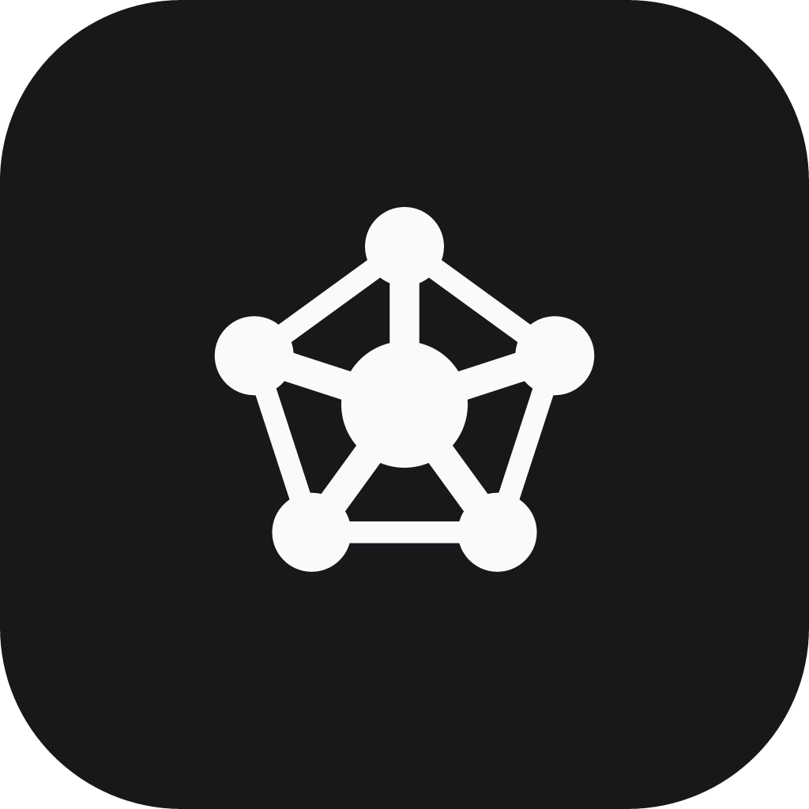
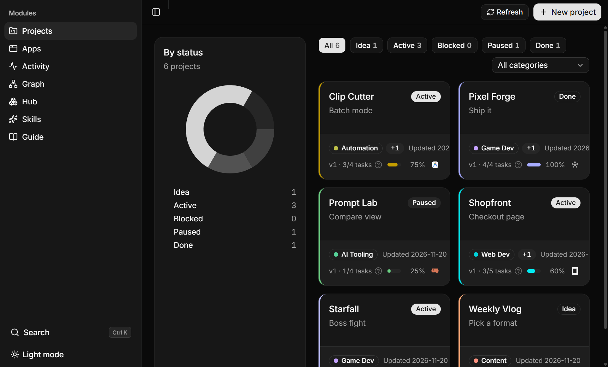
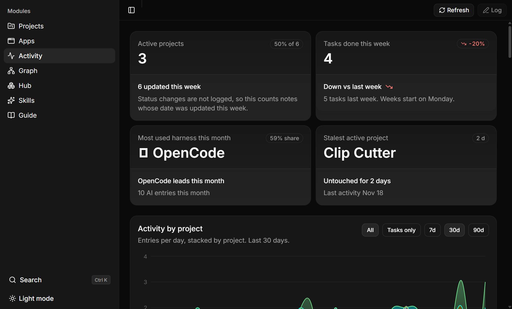
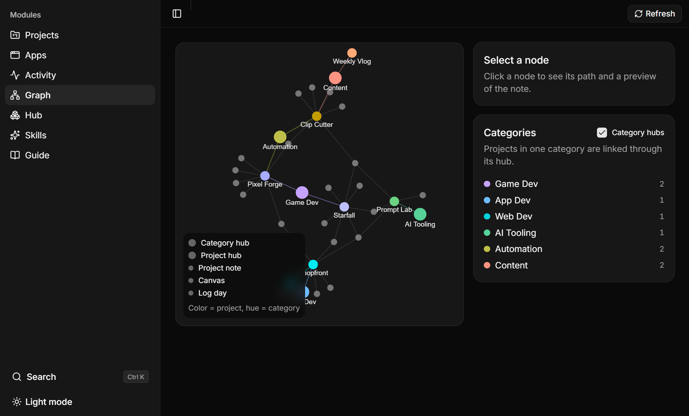
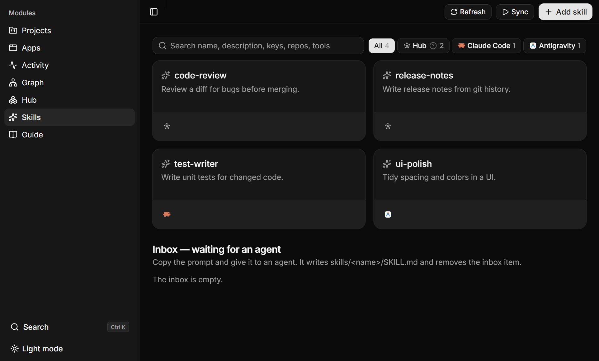
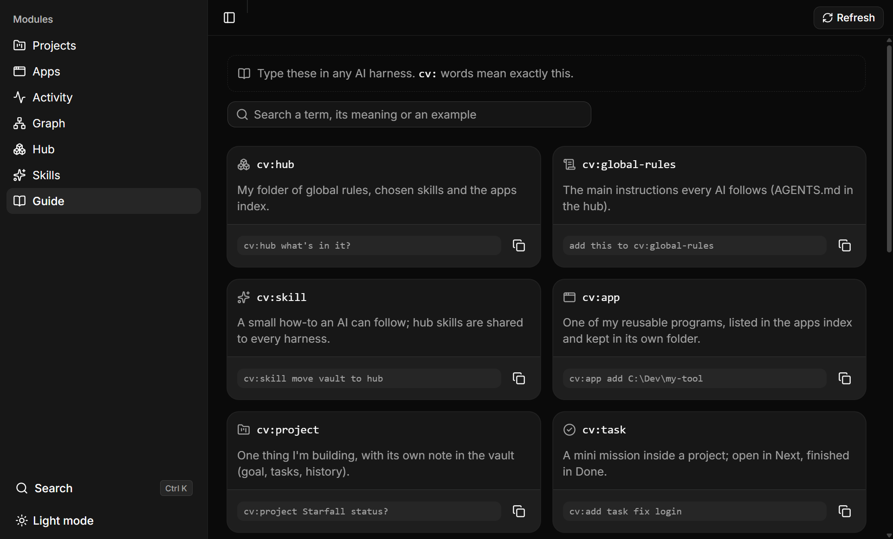

<div align="center">



# Corvoid Hub

**One desktop dashboard for everything your AI coding agents work on.**

[](https://github.com/hdrsniped/corvoid-hub/releases)
[](LICENSE)
[](#install)
[](https://tauri.app)
[](https://react.dev)
[](https://ui.shadcn.com)
[](https://obsidian.md)



</div>

If you switch between **Claude Code**, **Antigravity** and **OpenCode**, your rules, skills and project notes end up scattered across three folders. Corvoid Hub puts them in one place, a plain folder of rules and skills plus an [Obsidian](https://obsidian.md) vault, and shows it as a dashboard: projects with progress, a timeline of who did what, a mind graph, and a skills manager.

The app is optional. Everything it does is a plain file edit, so any AI agent can do the same work without it (see [AGENTS.md](AGENTS.md)).

## Highlights

- **Projects**: cards with status, category colors, task progress (`3/5`), versions (v1 → v2) and the harness that last touched it.
- **Activity**: a stacked chart of work per project, harness usage and a log timeline. Quick log with `Ctrl+L`.
- **Mind graph**: projects, notes and log days, linked by wikilinks.
- **Skills**: hub skills shared to every harness, plus each harness's own. Move a skill between the hub, Claude Code and Antigravity, or remove it (it goes to a backup, never hard-deleted).
- **Transfer**: one copy-paste prompt that hands a project to another harness with everything it needs.
- **Locks**: mark a folder read-only, or no-ai to keep agents out completely.
- **Apps and Guide**: an index of your reusable tools and a shared vocabulary (`cv:task`, `cv:version` …) that every agent reads the same way.
- **Search everything** with `Ctrl+K`.

## Screenshots

| Activity | Mind graph |
|---|---|
|  |  |
| **Skills** | **Guide** |
|  |  |

## Install

1. Download `Corvoid Hub_1.0.0_x64-setup.exe` from [Releases](https://github.com/hdrsniped/corvoid-hub/releases) and run it.
2. Tell the app where your hub and vault are (see [Configure](#configure)). With no config it looks in `%USERPROFILE%\ai-hub` and `%USERPROFILE%\Documents\Vortex`.

It needs the Microsoft Edge WebView2 Runtime, which Windows 10 and 11 already include.

New to all this? Copy [`examples/hub`](examples/hub) and [`examples/vault`](examples/vault) somewhere, point the config at them, and open the app.

## Configure

The app reads one JSON file, the first one it finds:

1. the path in the environment variable `CORVOID_HUB_CONFIG`
2. `corvoid-hub.json` next to the executable
3. `%USERPROFILE%\.corvoid-hub.json`

```json
{
  "hub": "C:\\Users\\you\\ai-hub",
  "vault": "C:\\Users\\you\\Documents\\Vortex",
  "vlog": "C:\\Users\\you\\tools\\vlog\\vlog.ps1",
  "needleLog": "C:\\Users\\you\\tools\\needle-log\\needle-log.ps1"
}
```

| Key | What | Default |
|---|---|---|
| `hub` | Your rules (`AGENTS.md`), `skills\`, `packs\`, `apps.yaml`, `categories.yaml`, `glossary.yaml`, `locks.yaml` | `%USERPROFILE%\ai-hub` |
| `vault` | Obsidian vault with `Projects\<Name>\<Name>.md` and `Log\YYYY-MM-DD.md` | `%USERPROFILE%\Documents\Vortex` |
| `vlog`, `needleLog` | Optional scripts for quick log | off |
| `logDir` | The app's own logs | `<hub>\.logs` |

## How it works

```
hub/                         vault/ (Obsidian)
  AGENTS.md   global rules     Projects/<Name>/<Name>.md   goal, Next, Done, History
  skills/     shared skills    Log/2026-11-20.md           - [[Starfall]] — #task Boss fight (claude code)
  apps.yaml   your tools
  locks.yaml  protected paths
```

- Each harness points at the same `AGENTS.md`, so they all follow one set of rules.
- Agents log finished work as one line in today's note. The app reads those lines to draw progress, activity and the graph.
- Hub skills are synced to each harness by `hub-sync.ps1` (for example with [skillshare](https://github.com/runkids/skillshare)).
- The app only reads and writes inside your hub, your vault and the harness skill folders.

## Build from source

Needs [Bun](https://bun.sh) and [Rust](https://rustup.rs).

```powershell
bun install
bun run tauri dev                    # live reload
bun run tauri build --bundles nsis   # installer in src-tauri/target/release/bundle/nsis
```

## Version history

See [CHANGELOG.md](CHANGELOG.md).

## License

[MIT](LICENSE)
